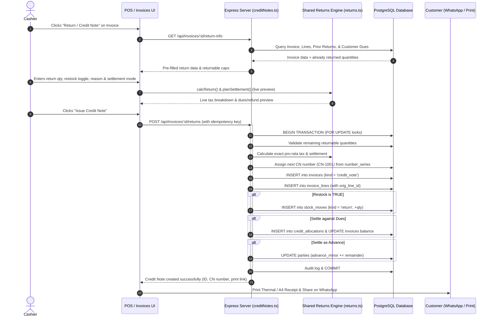

# Complete Flow of Returns and Credit Notes in Adaptive Billing

This document provides a comprehensive, technical, and operational walkthrough of how **Returns** and **Credit Notes** work across the entire architecture of this billing software.

---

## 1. Core Architectural Principles & Invariants

1. **Original Invoices Are Never Edited or Deleted**:
   - In accordance with GST statutory compliance and strict financial auditability, a posted invoice is an immutable legal record.
   - When goods are returned, the original invoice (`kind = 'sale'`) remains intact.
   - All reversals take place through a newly created, permanently linked document: a **Credit Note** (`kind = 'credit_note'`) referencing `linked_invoice_id`.

2. **Atomic Triple Reversal (All-or-Nothing)**:
   Whenever a return is confirmed, the system atomically executes three reversals within a single database transaction:
   - **Financial / Settlement Reversal**: Clears unpaid invoice dues, creates Customer Advance, or records a Cash/UPI refund.
   - **Inventory / Stock Reversal**: Restocks items back into inventory if marked restockable (`restock = true`).
   - **Tax & Accounting Reversal**: Proportionately reverses CGST, SGST, or IGST output tax and net revenue in business reports.

3. **Multi-Return Support with Concurrency Protection**:
   - A single invoice can have multiple partial returns across different days or counters until all items are fully returned.
   - Row-level locking (`SELECT ... FOR UPDATE`) guarantees that two cashiers cannot return the same line item concurrently.

---

## 2. End-to-End Return Execution Flow



---

## 3. Step-by-Step Technical Lifecycle

### Step 1: Return Initiation & Returnable Cap Inspection
- **Trigger**: The cashier clicks **"Return / Credit Note"** on a bill row in the Invoices table or within the Invoice Detail modal.
- **Endpoint**: `GET /api/invoices/:id/return-info` in [`server/src/routes/creditNotes.ts`](file:///c:/billing-software/server/src/routes/creditNotes.ts#L13-L189).
- **Processing**:
  1. Checks invoice validity (cannot return against a credit note, cancelled invoice, or voided invoice).
  2. Queries all posted credit notes previously issued against this bill (`WHERE linked_invoice_id = :id AND status = 'posted'`).
  3. Computes:
     $$\text{Returnable Qty} = \text{Billed Qty} - \sum(\text{Already Returned Qty})$$
  4. If `Returnable Qty = 0` across all items, the return action is marked as **Fully Returned**.
  5. Retrieves customer dues across any other outstanding credit bills to allow cross-bill settlement.

---

### Step 2: Line Item Selection & Validation
Inside the return modal ([`client/src/App.tsx`](file:///c:/billing-software/client/src/App.tsx#L14410)):
- **Per-Line Return Quantity**: Accepts any quantity between `0` and `Returnable Qty`. Fractional quantities are permitted for weighed goods (e.g., kg).
- **Restock Toggle (`restock`)**:
  - `Yes` (Default): Item is in sellable condition; stock will be returned to shelf.
  - `No`: Item is damaged, expired, or opened; credit is given, but inventory is **not** increased.
- **Mandatory Return Reason**:
  - Preset options: `Damaged`, `Defective`, `Wrong Item`, `Customer Changed Mind`, `Expired`, `Other`.
  - If `Other` is chosen, custom explanatory text is mandatory.

---

### Step 3: Pro-Rata Math & GST Reversal Calculation
- Handled by [`shared/returns.ts`](file:///c:/billing-software/shared/returns.ts#L83-L160) (`calcReturn`):
- To prevent fractional paisa errors on partial returns, tax reversals are computed proportionately:
  $$\text{Taxable Reversal} = \left\lfloor \frac{\text{Orig Taxable} \times \text{Return Qty}}{\text{Billed Qty}} + 0.5 \right\rfloor$$
  $$\text{CGST Reversal} = \left\lfloor \frac{\text{Orig CGST} \times \text{Return Qty}}{\text{Billed Qty}} + 0.5 \right\rfloor$$
  $$\text{SGST Reversal} = \left\lfloor \frac{\text{Orig SGST} \times \text{Return Qty}}{\text{Billed Qty}} + 0.5 \right\rfloor$$
- **Final Line Reconciliation**: When the final remaining quantity of an item is returned, the engine reconciles past returns against the original bill line so the sum of all credit notes matches the original bill down to the exact paisa (0 paisa leakage).

---

### Step 4: Settlement Planning
Handled by [`shared/returns.ts`](file:///c:/billing-software/shared/returns.ts#L162-L278) (`planSettlement`):
The credit value is settled through one of three paths:

| Original Invoice State | Settlement Path | Action Taken |
| :--- | :--- | :--- |
| **Unpaid Dues on Original Bill** | **Reduce Bill Dues** (Automatic) | Reduces `balance_minor` and increments `paid_minor` on the original bill. Recorded in `credit_allocations`. |
| **Original Bill Fully Paid + Registered Customer** | **Customer Advance** OR **Immediate Refund** | Cashier chooses: (1) Add to customer's advance wallet (`parties.advance_minor`) for future bills, or (2) Pay back via Cash, UPI, Card, or Bank. |
| **Walk-in Customer (No Customer Account)** | **Immediate Refund Only** | Mandatory refund in Cash, UPI, Card, or Bank. Walk-ins cannot hold advance balances. |

---

### Step 5: Atomic Database Commit (`POST /api/invoices/:id/returns`)
Implemented in [`server/src/routes/creditNotes.ts`](file:///c:/billing-software/server/src/routes/creditNotes.ts#L192-L630):
1. **Idempotency Guard**: Checks `idempotency_key` to prevent duplicate submissions on double clicks.
2. **Database Transaction**:
   - Acquires `FOR UPDATE` locks on the original invoice, invoice lines, and customer party.
   - Verifies returnable quantities to prevent race conditions.
   - Generates sequential Credit Note Number: `CN-1001`, `CN-1002`, etc., using [`number_series`](file:///c:/billing-software/server/src/db/schema.ts#L89-L94).
3. **Insert Credit Note**:
   - Inserts record into `invoices` with `kind = 'credit_note'`, `status = 'posted'`, and `linked_invoice_id = orig_invoice_id`.
4. **Insert Credit Note Lines**:
   - Inserts into `invoice_lines` with `orig_line_id` linking back to the sold line item.
5. **Inventory Update (`stock_moves`)**:
   - For every line where `restock = true` and `item_id IS NOT NULL`:
     ```sql
     INSERT INTO stock_moves (
       tenant_id, item_id, location, qty_milli, kind, ref_type, ref_id, user_id, reason
     ) VALUES (
       :tenant_id, :item_id, 'MAIN', :return_qty, 'return', 'credit_note', :cn_id, :user_id, :reason
     );
     ```
6. **Dues & Khata Updates**:
   - Inserts record into `credit_allocations` for each invoice whose dues are cleared.
   - Updates target invoices: `balance_minor = balance_minor - :alloc`, `paid_minor = paid_minor + :alloc`.
   - If advance was chosen: `UPDATE parties SET advance_minor = advance_minor + :advance`.
7. **Audit Trail**: Logs `credit_note.create` with full line and settlement details.

---

### Step 6: Cash Register & Active Shift Drawer Impact
When a return is settled via **Cash Refund** (`settlementType = 'refund'` and `refundMode = 'cash'`):
1. Cash is physically taken out of the drawer and handed to the customer.
2. [`server/src/routes/shifts.ts`](file:///c:/billing-software/server/src/routes/shifts.ts#L182-L218) detects refunds paid during the active shift:
   ```sql
   SELECT COALESCE(SUM(refund_amount_minor), 0) AS cash_refunds_minor
   FROM invoices cn
   WHERE cn.linked_invoice_id = ... AND cn.refund_mode = 'cash'
   ```
3. The cashier's shift summary subtracts cash refunds:
   $$\text{Expected Cash} = \text{Opening Cash} + \text{Cash Sales} + \text{Cash In} - \text{Cash Out} - \mathbf{Cash\ Refunds}$$
4. At shift closing reconciliation, the expected cash in drawer matches the physical cash counted.

---

### Step 7: GST Reporting & Sales Analytics
1. **GSTR-1 Compliance** ([`server/src/routes/gst.ts`](file:///c:/billing-software/server/src/routes/gst.ts#L49)):
   - Posted credit notes are included in GSTR-1 **Section 9B (Credit/Debit Notes Registered)** or **CDNUR (Unregistered)**.
   - Displays Credit Note number, date, original invoice number, taxable reversal, and GST split.
2. **Sales Analytics & Dashboard**:
   - Gross Sales = Total sales invoices.
   - Returns Total = Total posted credit notes (`i.kind = 'credit_note'`).
   - Net Sales = $\text{Gross Sales} - \text{Returns Total}$.
   - COGS and units sold are adjusted downward by the returned quantity.

---

## 4. Voiding a Credit Note (Rollback Flow)

If a credit note was issued by mistake:
- **Authorization**: **Owner** or **Store Manager** only (cashiers cannot void credit notes).
- **Endpoint**: `POST /api/credit-notes/:id/void` in [`server/src/routes/creditNotes.ts`](file:///c:/billing-software/server/src/routes/creditNotes.ts#L1010-L1132).
- **Validation**: Checks if customer advance created by this credit note has already been spent on a subsequent bill. If spent, the void is blocked with `ADVANCE_CONSUMED`.
- **Atomic Rollback**:
  1. **Stock Rollback**: Inserts a negative stock move (`kind = 'adjust'`, `-qty_milli`) to take the restocked items back out of inventory.
  2. **Dues Rollback**: Reverses `credit_allocations` by adding the balance back onto the invoices (`balance_minor += alloc`, `paid_minor -= alloc`).
  3. **Advance Rollback**: Deducts `advance_minor` from the customer's account.
  4. **Status Update**: Marks the credit note as `status = 'voided'` with `void_reason`, `voided_by`, and `voided_at`.

---

## 5. File & Component Directory Reference

| Layer | File Path | Primary Responsibility |
| :--- | :--- | :--- |
| **Specification** | [`specs/Returns and Credit Notes Spec.md`](file:///c:/billing-software/specs/Returns%20and%20Credit%20Notes%20Spec.md) | Feature specification, rules, and mathematical formulas |
| **Calculation Engine** | [`shared/returns.ts`](file:///c:/billing-software/shared/returns.ts) | `calcReturn()`, `planSettlement()`, pro-rata GST splitting |
| **Backend API** | [`server/src/routes/creditNotes.ts`](file:///c:/billing-software/server/src/routes/creditNotes.ts) | Return info, atomic creation, printing, WhatsApp share, voiding |
| **Database Schema** | [`server/src/db/schema.ts`](file:///c:/billing-software/server/src/db/schema.ts#L106-L157) | Tables: `invoices`, `invoice_lines`, `credit_allocations`, `stock_moves` |
| **Shift Impact** | [`server/src/routes/shifts.ts`](file:///c:/billing-software/server/src/routes/shifts.ts#L182-L218) | Deducting cash refunds from cashier register shift drawer |
| **Document Rendering** | [`shared/bill.ts`](file:///c:/billing-software/shared/bill.ts) | `renderCreditNoteDoc()`: 58mm/80mm thermal and A4 document layouts |
| **Frontend Modal** | [`client/src/App.tsx`](file:///c:/billing-software/client/src/App.tsx#L14410-L14550) | Return line inputs, live summary cards, settlement selector, save modal |
